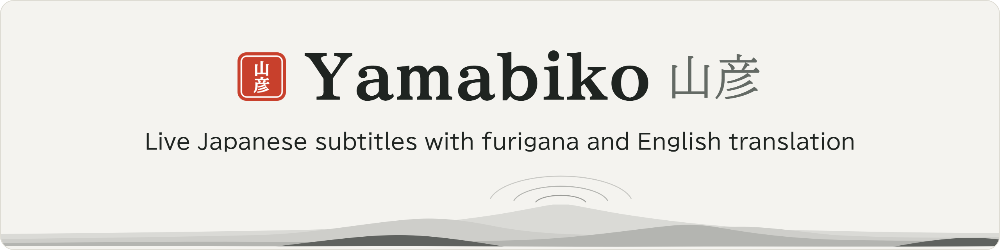
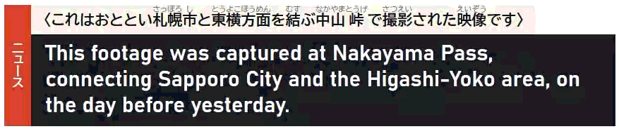
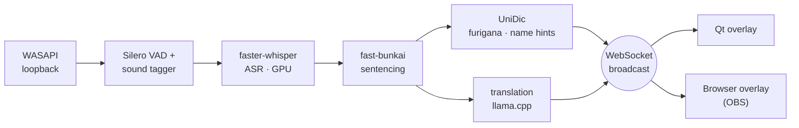

<p align="center">
  <picture>
    <source media="(prefers-color-scheme: dark)" srcset="assets/banner-dark.png" />
    
  </picture>
</p>

<p align="center">
  Real-time Japanese subtitles with furigana and English translation, drawn on an always-on-top overlay.<br/>
  Japanese speech recognition with Kodama-1, Yamabiko's own speech model, running on your own NVIDIA graphics card.<br/>
  Your audio and subtitles stay on your PC. No telemetry, API keys, accounts, or usage fees.
</p>

<p align="center">
  <a href="https://github.com/Yamabiko-ASR/yamabiko/releases/latest"></a>
  
  
  
  <a href="LICENSE"></a>
</p>

<p align="center">
  <a href="OVERVIEW.md">Overview</a>
  ·
  <a href="docs/ROADMAP.md">Roadmap</a>
  ·
  <a href="CHANGELOG.md">Changelog</a>
  ·
  <a href="SUPPORT.md">Support</a>
  ·
  <a href="docs/design/">Design notes</a>
</p>

<p align="center">
  
</p>

---

## What it does

Yamabiko listens to any Windows audio source over WASAPI loopback, transcribes the Japanese, and draws subtitles with furigana and a live English translation on an overlay that floats above whatever you're watching.

It's built for one thing: watching Japanese streams, videos, and games without losing the speaker's voice. It expects Japanese audio, and it isn't a meeting tool or a general transcription app.

Speech recognition runs on your own graphics card, so there are no usage fees or rate limits. Your audio and subtitles stay on your PC.

Yamabiko is in beta, so expect rough edges. To report one, see [Contact](#contact).

## Features

- **Loopback capture.** Yamabiko captures what any Windows audio output plays, through [PyAudioWPatch](https://github.com/s0d3s/PyAudioWPatch).
- **Voice detection.** A [pinned community Silero VAD v5-era ONNX graph](https://huggingface.co/onnx-community/silero-vad) runs through `onnxruntime`, with silence thresholds tuned for Japanese. A bundled [EfficientSED](https://github.com/theMoro/EfficientSED) sound tagger also listens for voices. It looks 0.24 seconds ahead, so subtitles appear about a quarter to three quarters of a second later.
- **Speech recognition.** [faster-whisper](https://github.com/SYSTRAN/faster-whisper) runs [Kodama-1](https://huggingface.co/Yamabiko-ASR/kodama-1), Yamabiko's own Japanese speech model, on the graphics card. Kodama-1 is a fine-tune of [whisper-ja-760M](https://huggingface.co/efwkjn/whisper-ja-760M), licensed under CC BY-SA 4.0.
- **Sentence splitting.** [fast-bunkai](https://github.com/hotchpotch/fast-bunkai) splits Japanese into sentences and handles decimals, URLs, and quoted speech.
- **Furigana.** A custom `QPainter` draws stacked furigana as true ruby over the kanji.
- **Name hints.** Names that UniDic and [SudachiPy](https://github.com/WorksApplications/sudachi.rs) find are matched against your glossary, a curated list of places and institutions, and the characters of the series you picked. The translator gets the matches as hints.
- **Local translation.** `Qwen3.5-9B` runs through [llama.cpp](https://github.com/ggml-org/llama.cpp), with prompts that follow the genre and the lines before.
- **Series-aware character names.** Pick the show you're watching in the series search (Ctrl+Alt+S), and character names follow the romanized spellings that [AniList](https://anilist.co) lists, for example Tanjirou Kamado.
- **Two overlays.** A native Qt window shows the subtitles by default, and a browser overlay shows them in OBS scenes.
- **Tray and shortcuts.** The tray icon and global shortcuts cover pause, genre, position, and live settings.

## How it works



Each stage is an async coroutine connected by bounded queues. The hot path is single-process, and the overlay renders in a separate Qt process that the pipeline spawns and owns. Above both sits a watchdog that restarts the pipeline and the local llama.cpp server after a crash. See [OVERVIEW.md](OVERVIEW.md) for the full pipeline and [docs/design/](docs/design/) for per-subsystem notes.

## Requirements

| Requirement | Standard tier | Smaller tier (8 GB cards) |
|---|---|---|
| **OS** | Windows 11 | Windows 11 |
| **Graphics card** | NVIDIA, Compute Capability 7.5 or later (RTX 20 series or later) | Same |
| **Driver** | An NVIDIA driver that supports CUDA 12. The installer includes the CUDA 12 runtime (cuBLAS, cuDNN, NVRTC), llama-server, and the Visual C++ runtime. | Same |
| **Video memory** | 10 GB free (an RTX 3060 12 GB or better) | 7 GB free (8 GB cards, such as the RTX 4060) |
| **RAM** | 16 GB | 16 GB |
| **Disk** | About 12 GB for the app and models | About 10 GB |
| **Network** | Needed the first time, to download the models from Hugging Face. After that, capture, transcription, and translation work offline. The update check, when it's on, and the series search still go online. | Same |

Setup reads your card's video memory and suggests a tier. **Smaller** runs the speech model at INT8/FP16 and a 4 GB translator quantization instead of 5.1 GB, for a total of about 6 to 7 GB of video memory, compared with 8 to 9 GB on **Standard**. Voice detection and sentence splitting are the same on both tiers. You can change the tier before the download starts, or later in **Settings** > **Audio & model**.

Yamabiko doesn't support AMD or Intel graphics cards, CPU-only inference, macOS, Linux, or Windows 10.

## Install Yamabiko

1. Download `yamabiko-<version>-setup.exe` (about 1.1 GB) from the [latest release](https://github.com/Yamabiko-ASR/yamabiko/releases/latest).
2. Run the installer. It installs into `%LOCALAPPDATA%\Yamabiko` for your account only, without asking for administrator rights. If Yamabiko is already installed, the installer offers to update it, and your settings stay. When an update needs new models, setup opens the next time Yamabiko starts and downloads only what's missing. Leave **Start Yamabiko** selected on the last page to start Yamabiko right away.
3. This beta isn't signed yet, so Windows might show "Windows protected your PC". Click **More info**, and then click **Run anyway**.

To uninstall Yamabiko, go to Windows **Settings** > **Apps** > **Installed apps**, or use its Start menu shortcut. Uninstalling keeps your models, settings, and logs, so a reinstall doesn't download the models again. The uninstaller's last page shows how much space they take and where they are, with a link that opens the folder. To remove them, delete `%LOCALAPPDATA%\Yamabiko`.

## Get started

1. Start Yamabiko from the installer's last page or the Start menu. The first time it starts, setup asks where the sound plays and what you watch most, suggests a model size for your graphics card, downloads the models (up to 7 GB, once), and checks the local translator.
2. Play Japanese audio in any app, on the output you picked.
3. Click the tray icon to open the flyout: pause, subtitles on or off, mode, genre, series, position, settings, and quit. Right-click it for a short menu.

To run setup again, for example to download the models again, quit Yamabiko from the tray, delete `%LOCALAPPDATA%\Yamabiko\state.json`, and start Yamabiko. Setup opens with your current choices and downloads only what's missing. To change only the audio output or the model size, use **Settings**. The genre is in the tray flyout.

## Use Yamabiko

| Feature | Details |
|---|---|
| **Shortcuts** | Ctrl+Alt+P pauses and resumes. While Yamabiko is paused, the banner beside the subtitles reads 一時停止, even when no subtitles are showing. Ctrl+Alt+O shows and hides the subtitles. Ctrl+Alt+S opens the series search. All three work in every app and are on by default. To change them, go to **Settings** > **Shortcuts**. Changes work right away. To turn them all off, set `hotkeys.enabled: false` in `%LOCALAPPDATA%\Yamabiko\user_overrides.yaml`. |
| **Genres** | **Variety**, **Anime**, **Drama**, and **News**. Each one tunes the translator's prompt for that kind of show. To switch, use the tray flyout. |
| **Series** | Press Ctrl+Alt+S, click **Pick a series** in the tray's right-click menu, or click **Change** in the flyout. A search bar opens at the top of the screen your subtitles are on. Type the show's name, and then press Enter or click the show. If you add your AniList username in **Settings**, the shows you're watching are listed before you type. The bar shows the character names loading, and then "Now watching …". From then on, that series' character names keep the romanized spellings AniList lists, instead of changing from line to line. Yamabiko remembers your pick and its cover after a restart. To go back to the genre alone, click **Clear** in the bar or the flyout. To turn off the feature, set `gazetteer.enabled: false`. |
| **Position** | In the tray flyout, **Position** has presets that put the subtitles at the bottom or the middle of any connected display. To place them exactly, click **Move subtitles**, drag the sample subtitle where you want it (it can move between monitors), and then press Enter to save. Clicks go through the subtitles to the window behind them, and the subtitles never take the keyboard focus. |
| **Subtitle look** | In **Settings**, the **Overlay** choices sit beside the preview on every tab. **Mode** is **Watch** (English first) or **Learn** (Japanese first, with colored readings). **Alignment** is **Left** or **Center**. **Echo** sets which language older lines keep as they fade. **Banner** shows Japanese, or Japanese and English. **Mode** and **Alignment** are also in the tray flyout. The banner shows the genre, or the Japanese title of the series you picked. |
| **Styling** | In **Settings**, you can change fonts, sizes, colors, **Background opacity**, the number of lines, how long lines stay and fade, and **Reduce motion**. Changes show right away. |
| **Faster subtitles** | Each sentence shows as soon as it's settled, instead of waiting for a pause. It's on by default. To turn it off, go to **Settings** > **Timing**. |
| **Notices** | If translations stop or your audio device goes away, a Windows notification tells you. Until the problem is fixed, an お知らせ line stays above the subtitles (on the browser/OBS page too), and the tray icon shows a small amber dot. If the bundled translator stops answering, Yamabiko restarts it. |
| **Proper nouns** | Picking a series keeps its character names spelled the same way. For names outside a series, or to fix a reading Yamabiko gets wrong, add an entry to `%LOCALAPPDATA%\Yamabiko\glossaries\user.yaml`. Yamabiko never edits this file, and its entries come before everything else. |
| **OBS and streaming** | Add `http://127.0.0.1:8765` to OBS as a Browser Source. It shows the same subtitles in the same design, with HTML `<ruby>` furigana that you can style with CSS. |

## Fix common problems

<details>
<summary><b>No subtitles appear</b></summary>

Check that Yamabiko isn't paused (a 一時停止 banner means it is; press Ctrl+Alt+P to resume), that Japanese audio is playing, and that the right audio device is selected in **Settings** > **Audio & model**.
</details>

<details>
<summary><b>Port 8090 is in use</b></summary>

The local llama.cpp server listens on `localhost:8090`. If another program already uses that port, the translation service stops right after it starts, and its message points to `llama-server.log`. If that program is itself a chat server (LM Studio, Ollama, or another llama-server), setup's translation check names the model that answered instead. Close the other program, or set `translation.endpoint` in `user_overrides.yaml`. A `localhost` endpoint on another port moves Yamabiko's own server to that port.
</details>

<details>
<summary><b>Models fail to load and your Windows user name is very long</b></summary>

Windows limits file paths to 260 characters unless long paths are turned on. With a very long user name, the path to the model folder can go over that limit, and a model fails to load with a "file not found" error even though the file is there.

To turn on long paths for the whole PC, run this in PowerShell as an administrator, and then restart your PC:

```powershell
Set-ItemProperty -Path 'HKLM:\SYSTEM\CurrentControlSet\Control\FileSystem' -Name 'LongPathsEnabled' -Value 1 -Type DWord
```

The installer doesn't ask for administrator rights, so it can't change this for you.
</details>

To attach your logs to a bug report, click the tray icon, and then click **Troubleshooting** > **Save diagnostics**. It saves your logs and a list of your setting names (never their values) to a zip file on your desktop, `yamabiko-diagnostics-<timestamp>.zip`, ready to attach to the issue. To attach logs yourself, use the `main-*.log` files in `%LOCALAPPDATA%\Yamabiko\logs\`, one for each part of Yamabiko: watchdog, pipeline, and overlay.

## Set up a development environment

<details>
<summary>To work on Yamabiko itself. To use Yamabiko, run the <a href="#install-yamabiko">installer</a> instead.</summary>

1. Create a Python 3.12 virtual environment (`uv venv`, or `conda create -n yamabiko python=3.12`).
2. Install the Python dependencies:

   ```powershell
   pip install -r requirements-dev.txt
   ```

   This installs the runtime dependencies and the test and release-gate
   tools (`requirements-dev.txt` includes `yamabiko/requirements.txt`).
   You don't need torch: Yamabiko uses `onnxruntime` for voice detection.
3. Build or download `llama-server.exe`, and put it in `third_party/llama.cpp/` with its CUDA DLLs. For the build recipe and the pinned commit, see [third_party/README.md](third_party/README.md).
4. Start `llama-server` with the translation GGUF. `scripts/start-llama-server.ps1` is a known-good launcher.
5. Run the pipeline:

   ```powershell
   python -m yamabiko.main
   ```

Setup also runs the first time you start Yamabiko from source, and it downloads the models into the shared Hugging Face cache at `%LOCALAPPDATA%\Yamabiko\hf-cache\`. Your settings are in `%LOCALAPPDATA%\Yamabiko\user_overrides.yaml`, a sparse file that overrides the bundled `yamabiko/default_config.yaml`. To check a config file and layer it over the shipped defaults instead of your own settings file, pass `--config path/to/config.yaml`.

To build the installer, create the release venv as the "Release venv" section of `docs/RELEASE.md` shows, and then run `installer\build.ps1 -Venv .venv-release`. The build refuses a venv whose packages differ from `constraints-release.txt`, so a dev `.venv` doesn't work. It needs PyInstaller 6.10 or later in that venv, NSIS 3.x Unicode, and the llama-server binaries from step 3. The installer is written to `installer/yamabiko-<version>-setup.exe`.
</details>

## License

Yamabiko is licensed under [PolyForm Noncommercial 1.0.0](LICENSE). It's source-available, not OSI open source. Personal, research, and nonprofit use is welcome. Commercial use needs a separate license; see [Contact](#contact). For the third-party licenses, see [NOTICE](NOTICE).

To contribute, read [CLA.md](CLA.md) and [CONTRIBUTING.md](CONTRIBUTING.md) first.

## Contact

- Help and bug reports: [support@kaze.be](mailto:support@kaze.be)
- General and community questions: [Yamabiko@kaze.be](mailto:Yamabiko@kaze.be)
- Commercial licensing: [licensing@kaze.be](mailto:licensing@kaze.be)
- Security reports: follow the private reporting steps in the [security policy](.github/SECURITY.md)

## Credits

Yamabiko stands on the work of many others. Particular thanks to:

- [OpenAI Whisper](https://github.com/openai/whisper), [SYSTRAN faster-whisper](https://github.com/SYSTRAN/faster-whisper), and [efwkjn](https://huggingface.co/efwkjn) for whisper-ja-760M, the Japanese Whisper model Kodama-1 is fine-tuned from
- [llama.cpp](https://github.com/ggml-org/llama.cpp) and the [Qwen team](https://huggingface.co/Qwen) for the translator, with the Japanese-tuned quantization by [dahara1](https://huggingface.co/dahara1)
- [Silero VAD](https://github.com/snakers4/silero-vad) and [EfficientSED](https://github.com/theMoro/EfficientSED)
- [fast-bunkai](https://github.com/hotchpotch/fast-bunkai)
- [cutlet](https://github.com/polm/cutlet) and [UniDic](https://clrd.ninjal.ac.jp/unidic/)
- [AniList](https://anilist.co) for the series and character-name data behind the series search
- [PyAudioWPatch](https://github.com/s0d3s/PyAudioWPatch)
- [Qt for Python (PySide6)](https://wiki.qt.io/Qt_for_Python)

---

<p align="center"><i>山彦, the echo that returns from the mountain.</i></p>
